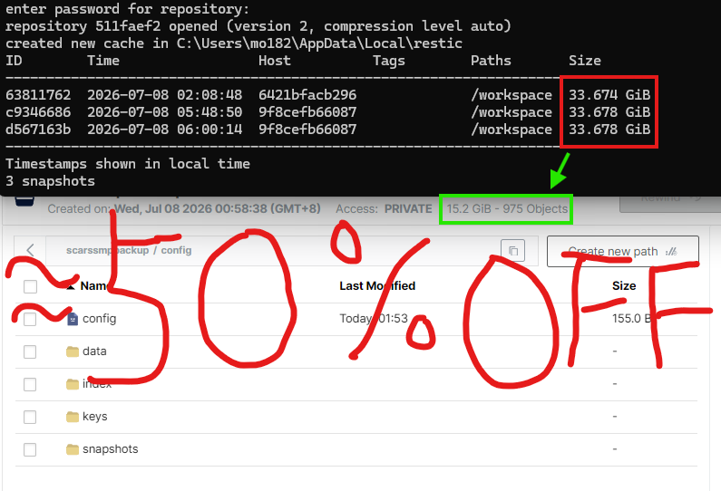

# MCDR2Restic

[](https://github.com/pfdr2333/MCDR2restic/actions/workflows/ci.yml)
[](LICENSE)

MCDReforged 插件：调用 [restic](https://restic.readthedocs.io/en/stable/) 对 Minecraft 服务器进行去重增量备份，支持定时调度、快照恢复与多通道通知。

**中文 | [English](README_EN.md)**

## 功能

- 定时备份：支持 6 位 cron 与固定间隔，可中途打断
- 无人游玩自动跳过：结合 join/left 事件与 `list` 在线检查
- 强制备份调度：不受玩家活动感知影响，默认关闭
- 自动下载 restic（Linux/Windows amd64），并支持代理前缀
- 快照恢复：整份快照、单文件、文件夹，支持恢复到指定目录
- 恢复前自动创建保护快照，失败自动回滚
- 仓库维护：`forget`/`prune` 等命令按计划独立执行
- 通知：OneBot QQ 与 Discord Webhook，可同时启用
- 中英双语消息与配置注释，跟随 MCDR 语言
- 配置安全检查：restic 仓库不得位于备份源目录内

## 演示

每个快照都是该时间点的完整备份，仅占用增量空间：



## 环境要求

- MCDReforged >= 2.12.0
- Python 依赖由 MCDR 按 `requirements.txt` 自动安装（`PyYAML`、`websocket-client`）

> 使用前建议先了解 restic 的基本概念与配置方法（[restic 手册](https://restic.readthedocs.io/en/stable/)）。插件的默认配置开箱即用，但远端仓库、保留策略等高级用法仍需要 restic 知识。

## 安装

1. 下载最新 [Release](https://github.com/pfdr2333/MCDR2restic/releases) 中的 `MCDR2Restic.mcdr`，放入 MCDR 的 `plugins/` 目录。
2. 重载插件（`!!MCDR reload all`）。首次加载会在 `config/mcdr2restic/config.yml` 自动生成适配当前系统的示例配置，默认即可运行：
   - 自动下载 restic、自动初始化本地仓库
   - 默认备份 `./server/world`（检测到三世界目录时自动全部写入）
   - Windows 下自动使用 `.\restic.exe` 等反斜杠路径并排除 `session.lock`
3. 按需修改配置后执行 `!!restic reload`。

> 示例密码 `123456` 仅用于降低上手门槛，正式使用请修改。
>
> OneBot 通知依赖包名为 `websocket-client`（导入名 `websocket`）。如果误装了同名的错误包导致 `websocket.WebSocketApp` 不存在，插件会给出提示。国内网络下依赖安装失败时，建议为 MCDR 使用的 Python 环境配置 PyPI 镜像或代理。

## 命令

| 命令 | 说明 |
| --- | --- |
| `!!restic status [p <页码>]` | 查看状态与快照列表 |
| `!!restic backup` | 立即备份 |
| `!!restic start` / `stop` | 启用 / 停用定时备份 |
| `!!restic init` | 手动初始化仓库 |
| `!!restic unlock` | 解锁仓库 |
| `!!restic maintenance` | 手动执行仓库维护 |
| `!!restic restore <快照>` | 添加整份快照恢复任务 |
| `!!restic restore <快照> file <路径>` | 添加单文件恢复任务 |
| `!!restic restore <快照> folder <路径>` | 添加文件夹恢复任务 |
| `!!restic restore <快照> to <目录>` | 添加整份快照恢复任务到指定目录（不停服） |
| `!!restic restore <快照> to <目录> file <路径>` | 添加单文件恢复任务到指定目录 |
| `!!restic restore <快照> to <目录> folder <路径>` | 添加文件夹恢复任务到指定目录 |
| `!!restic restore list` | 查看恢复任务队列 |
| `!!restic restore apply` | 执行恢复任务队列 |
| `!!restic unrestore <ID>\|all` | 删除某个 / 所有恢复任务 |
| `!!restic reload` | 重载配置 |

默认命令权限等级为 `3`，可在配置中修改。

恢复任务不会立即执行。`restore apply` 时：

- **恢复到服务器工作目录**（默认）：先创建保护快照，再停止 Minecraft、恢复文件、重启服务端；恢复失败自动回滚到保护快照。
- **恢复到指定目录**（所有任务都带 `to` 时）：不停止服务器，直接执行恢复；目标目录不得位于 restic 仓库或备份源目录内。

## 文档

完整配置说明、调度策略与常见问题见 [docs/zh_CN](docs/zh_CN/index.md)：

- [快速开始](docs/zh_CN/getting-started.md)
- [命令说明](docs/zh_CN/commands.md)
- [配置说明](docs/zh_CN/configuration.md)
- [状态与恢复](docs/zh_CN/restore-and-status.md)
- [常见问题](docs/zh_CN/faq.md)

## 开发与构建

```bash
# 运行测试（覆盖率不低于 55%）
python -m coverage run --branch --source=mcdr2restic,tools -m unittest discover -s tests -p "test_*.py"
python -m coverage report --fail-under=55

# 打包 .mcdr 归档
python tools/pack_plugin.py --output-dir dist
```

修改 `lang/zh_cn.json` 或 `en_us.json` 后需运行 `python tools/sync_language_resources.py` 重新生成 `zh_tw` 并同步两份语言文件。

GitHub Actions 会在每次推送时运行测试并保存构建产物；推送形如 `v0.6.0` 的 Git 标签会自动构建并创建 Release。

## 贡献

欢迎提交 Issue 与 Pull Request。

## 许可证

本项目基于 [GPL-3.0](LICENSE) 许可证发布。
