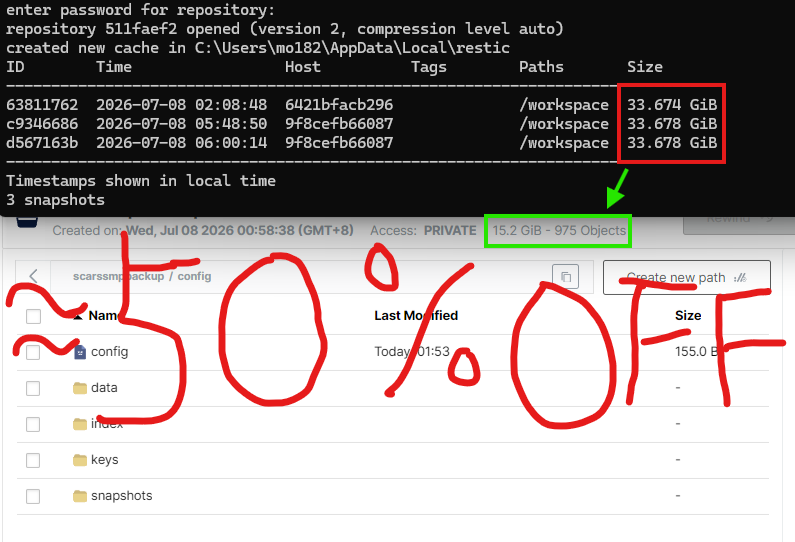

# MCDR2Restic

[](https://github.com/pfdr2333/MCDR2restic/actions/workflows/ci.yml)
[](LICENSE)

An MCDReforged plugin that runs [restic](https://restic.readthedocs.io/en/stable/) deduplicated incremental backups for Minecraft servers, with scheduling, snapshot restore, and multi-channel notifications.

**[中文](README.md) | English**

## Features

- Scheduled backups via 6-field cron or fixed intervals; a running backup can be interrupted
- Skips scheduled backups when nobody is playing, using join/left events plus a `list` online check
- Forced backup scheduling that ignores player activity (disabled by default)
- Automatic restic download (Linux/Windows amd64) with configurable proxy prefixes
- Snapshot restore: full snapshot, single file, or folder — including restore into a chosen directory
- Automatic pre-restore safety snapshot with rollback on failure
- Repository maintenance: `forget`/`prune` and friends, scheduled independently
- Notifications via OneBot QQ, Discord, and a custom webhook, all can be enabled at once
- Bilingual (Chinese/English) messages and config comments, following the MCDR language
- Configuration safety check: the restic repository must not sit inside a backup source

## Demo

Every snapshot is a complete backup of its point in time while only consuming incremental storage:



## Requirements

- MCDReforged >= 2.12.0
- Python dependencies are installed by MCDR from `requirements.txt` (`PyYAML`, `websocket-client`)

> Familiarize yourself with basic restic concepts before using this plugin ([restic manual](https://restic.readthedocs.io/en/stable/)). The default configuration works out of the box, but advanced use cases such as remote repositories and retention policies still require restic knowledge.

## Installation

The plugin is published in the MCDR plugin repository — one command installs it:

```text
!!MCDR plugin install mcdr2restic
```

Updating later is also a one-liner:

```text
!!MCDR plugin install -U mcdr2restic
```

Manual installation: grab `MCDR2Restic.mcdr` from the latest [Release](https://github.com/pfdr2333/MCDR2restic/releases), drop it into MCDR's `plugins/` directory, and run `!!MCDR reload all`. On first load a sample configuration tailored to your system is generated at `config/mcdr2restic/config.yml` — the defaults just work:

- restic is downloaded automatically and the local repository initialized
- `./server/world` is backed up by default (all three world directories are added when detected)
- On Windows the sample uses `.\restic.exe`-style backslash paths and excludes `session.lock`

Adjust the configuration as needed, then run `!!restic reload`.

> Only the world directories are backed up by default. For full restore capability, consider backing up the entire `./server` directory or even the whole MCDR root, protecting server files beyond the save data.
>
> The example password `123456` only lowers the entry barrier — change it for production use.
>
> The OneBot dependency is named `websocket-client` (imported as `websocket`). If a conflicting package with the same name is installed, the plugin reports the problem. If dependency installation fails behind mainland-China networks, configure a PyPI mirror or proxy for the Python environment MCDR uses.

## Commands

| Command | Description |
| --- | --- |
| `!!restic status [p <page>]` | Show status and the snapshot list |
| `!!restic backup` | Trigger an immediate backup |
| `!!restic start` / `stop` | Enable / disable scheduled backups |
| `!!restic init` | Initialize the repository manually |
| `!!restic unlock` | Unlock the repository |
| `!!restic maintenance` | Run repository maintenance manually |
| `!!restic restore <snapshot>` | Queue a full-snapshot restore |
| `!!restic restore <snapshot> file <path>` | Queue a single-file restore |
| `!!restic restore <snapshot> folder <path>` | Queue a folder restore |
| `!!restic restore <snapshot> to <dir>` | Queue a full-snapshot restore into a chosen directory (no server stop) |
| `!!restic restore <snapshot> to <dir> file <path>` | Queue a single-file restore into a chosen directory |
| `!!restic restore <snapshot> to <dir> folder <path>` | Queue a folder restore into a chosen directory |
| `!!restic restore list` | Show queued restore tasks |
| `!!restic restore apply` | Apply the restore task queue |
| `!!restic restore apply --skip-safety` | Apply the restore task queue without a safety snapshot |
| `!!restic unrestore <ID>\|all` | Delete one / all restore tasks |
| `!!restic reload` | Reload configuration |

The default command permission level is `3` and can be changed in the configuration.

Queued tasks are not executed immediately. When running `restore apply`:

- **Restore into the server working directory** (default): a safety snapshot is created first, then Minecraft is stopped via MCDR, files are restored, and the server starts again; failures roll back to the safety snapshot automatically. Adding `--skip-safety` skips the safety snapshot — rollback is then impossible, so use it carefully.
- **Restore into a chosen directory** (when every task carries `to`): the server keeps running while the restore executes; target directories inside the restic repository or backup sources are rejected.

## Documentation

Full configuration references, scheduling details, and FAQs live in the [online docs](https://m2r.pfdr.cc/) (Chinese; sources under [docs/](docs/index.md)):

- [Getting started](docs/getting-started.md)
- [Commands](docs/commands.md)
- [Configuration](docs/configuration.md)
- [Restore & status](docs/restore.md)
- [FAQ](docs/faq.md)

## Development & Build

```bash
# Run tests (coverage must stay at or above 55%)
python -m coverage run --branch --source=mcdr2restic,tools -m unittest discover -s tests -p "test_*.py"
python -m coverage report --fail-under=55

# Build the .mcdr archive
python tools/pack_plugin.py --output-dir dist

# Preview the docs site locally (Material for MkDocs)
pip install -r requirements-docs.txt
mkdocs serve
```

After editing `lang/zh_cn.json` or `en_us.json`, run `python tools/sync_language_resources.py` to regenerate `zh_tw` and keep both language file copies in sync; CI verifies that both `lang/` copies match and fails when they do not.

GitHub Actions runs the tests and stores build artifacts on every push; pushing a tag like `v0.6.0` builds the archive and publishes a release automatically.

## Contributing

Issues and pull requests are welcome.

## License

This project is released under the [GPL-3.0](LICENSE) license.
